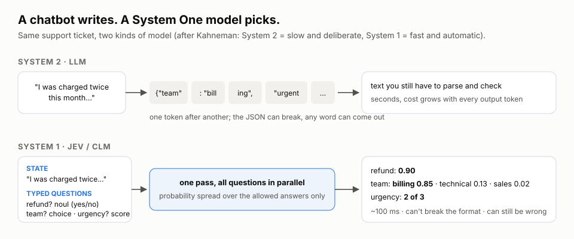
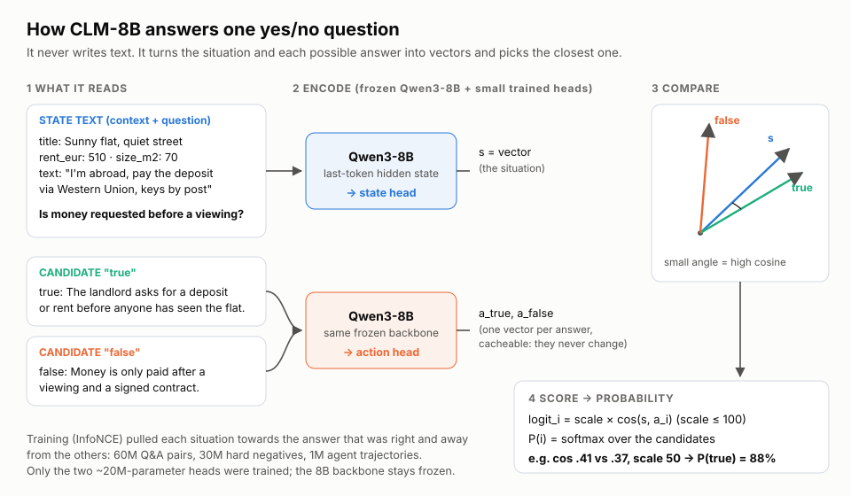
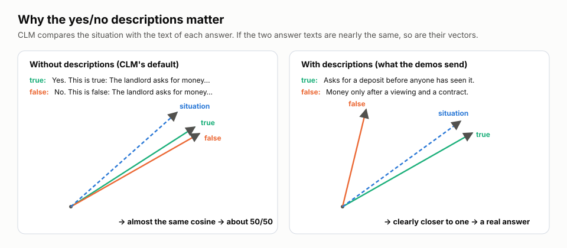
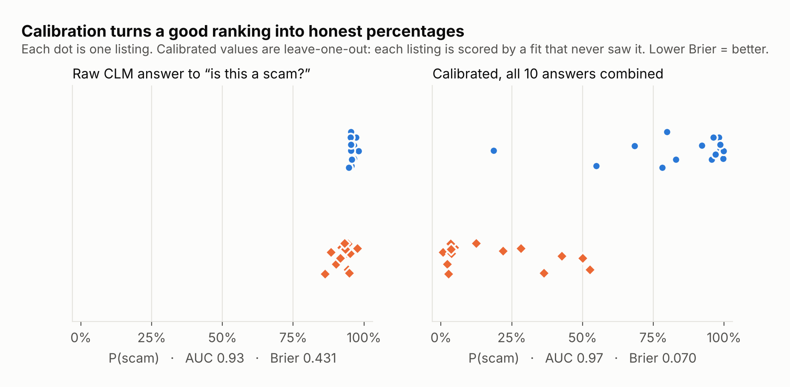
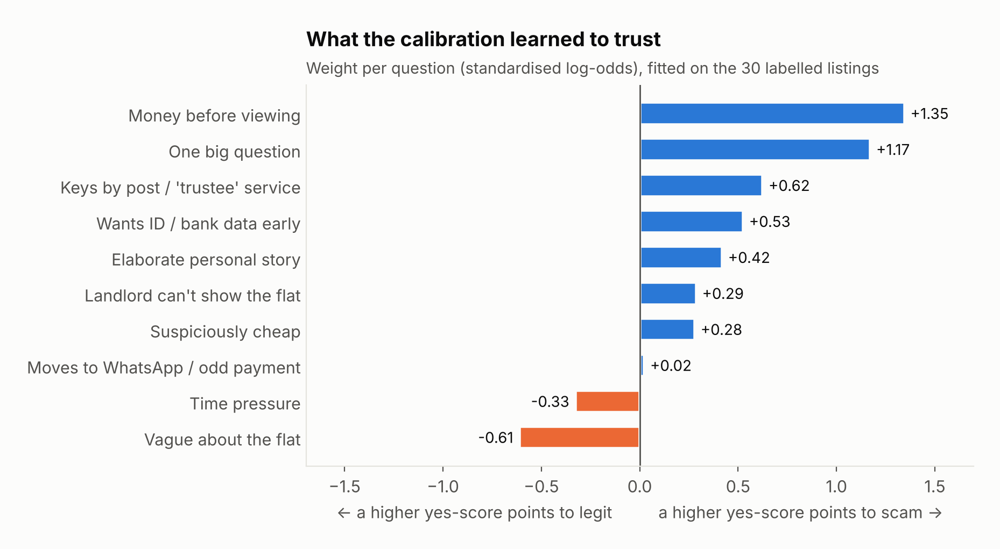
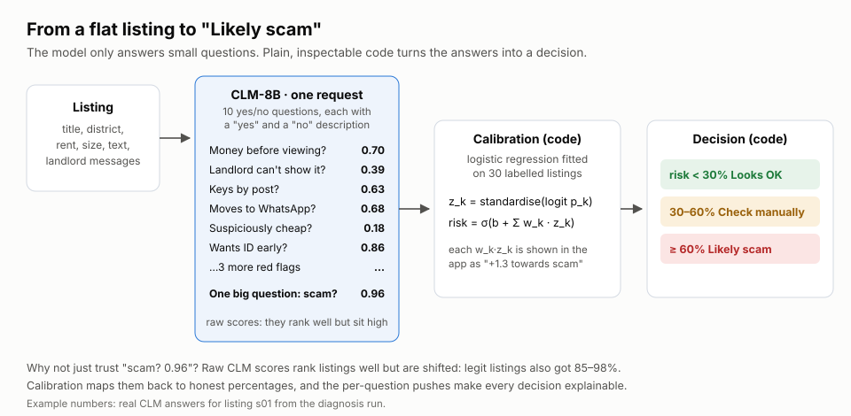
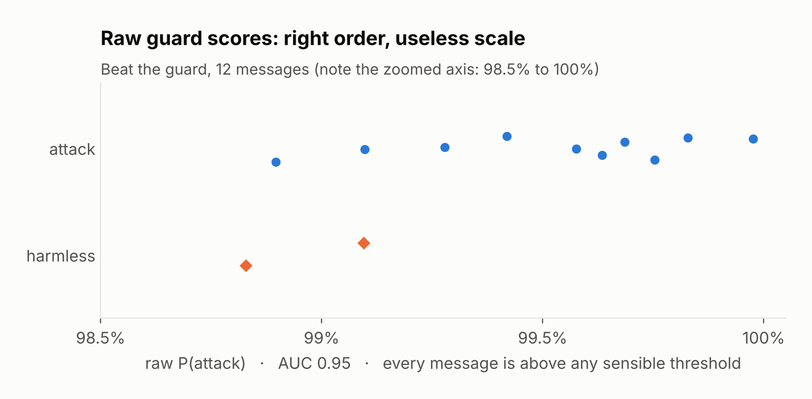
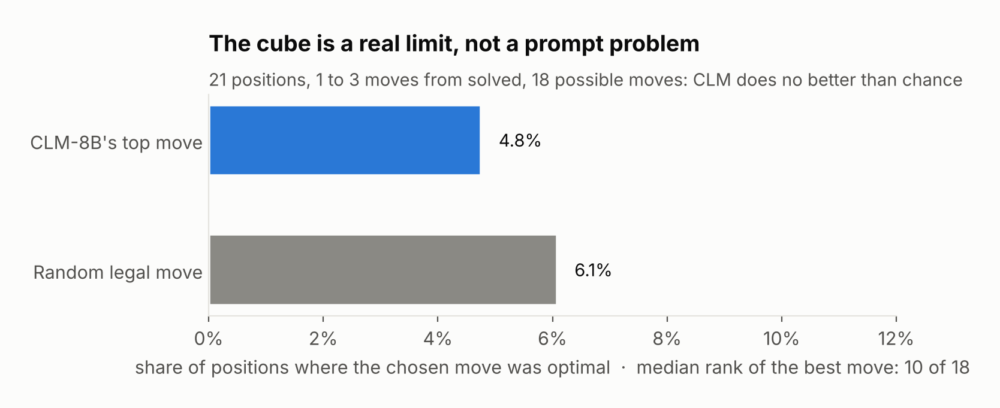

# Behind the scenes: how a decision model forms its answer

This page explains what happens between "send the listing" and "Likely scam". It covers the theory behind System One models (Jev and CLM-8B), how CLM-8B turns text into a probability, and why the way you write a question changes the answer. It also covers what we measured on our own demos with the real model on the BHT cluster.

> Looking for who else builds decision models now (Google, Perplexity, AWS, OpenAI, vLLM Semantic Router)? See the [landscape update, Nov 2026](landscape-update-2026-11.md).

1. [System 1 vs System 2](#1-system-1-vs-system-2)
2. [What you send and what comes back](#2-what-you-send-and-what-comes-back)
3. [How CLM-8B computes an answer](#3-how-clm-8b-computes-an-answer)
4. [How Jev differs](#4-how-jev-differs)
5. [Why the wording of a question matters](#5-why-the-wording-of-a-question-matters)
6. [From raw scores to honest probabilities: calibration](#6-from-raw-scores-to-honest-probabilities-calibration)
7. [Many small questions instead of one big one](#7-many-small-questions-instead-of-one-big-one)
8. [Where it breaks: the guard and the cube](#8-where-it-breaks-the-guard-and-the-cube)
9. [Reproduce every number on this page](#9-reproduce-every-number-on-this-page)

---

## 1. System 1 vs System 2

The terms come from Daniel Kahneman's *Thinking, Fast and Slow*:

- **System 2** is slow and deliberate, like working out 17 × 24 in your head. An LLM that writes its reasoning one token at a time is doing System 2 work.
- **System 1** is fast and automatic, like knowing 2 × 2 = 4 or reading a face. A **System One model** is built only for this kind of snap judgment.



A System One model **never writes text**. You give it a situation (the *state*) and a few *typed questions*. For each question it spreads 100% of probability over the answers you allowed, and nothing else can come out.

That has two consequences:

- **It cannot break the format.** You never get malformed JSON or an option you didn't offer. TypeSafe calls this "can't hallucinate".
- **It can still pick the wrong option.** The probability tells you how sure it is. Confidence is not evidence, though, so it needs checking (sections 6–8).

## 2. What you send and what comes back

Both models speak the same API (`POST /v1/systemone`). The scam demo sends the listing as the state, plus ten questions. One of them looks like this:

```json
{
  "state": {"title": "Sunny flat, quiet street", "rent_eur": 510, "text": "I'm abroad, pay the deposit via Western Union…"},
  "questions": {
    "pay_before_viewing": {
      "type": "noul",
      "instructions": "Does the landlord ask for money before a viewing?",
      "criteria": {
        "true":  "The landlord asks for a deposit or rent before anyone has seen the flat.",
        "false": "Money is only paid after a viewing and a signed contract."
      }
    }
  }
}
```

There are three question types:

| Type | Asks | Returns | Used in |
|---|---|---|---|
| `noul` | Is this true? | one probability, 0–1 | scam red flags, guard "is this an attack?" |
| `choice` | Which of these options? | a probability for every option | next cube move, guard "which technique?" |
| `score` | Where on this scale? | a probability per level + the expected level | – |

Every question is answered **in parallel against the same state**. Adding a question barely changes the response time: in the app, ten questions take about as long as one.

## 3. How CLM-8B computes an answer

CLM-8B is an open-weights model from Stanford/NVIDIA that we host ourselves (see [`k8s/`](../k8s)). It treats every decision as a **matching problem**:



1. **Build two kinds of text.**
   - The *state text* is the situation followed by a blank line and the question. Dicts are rendered as `key: value` lines, because the model was trained on prose, not JSON.
   - There is one *candidate text* per possible answer. For a yes/no question these are `true: <yes description>` and `false: <no description>`.
2. **Encode them.**
   - A frozen Qwen3-8B reads each text, and the hidden state of the last token is taken.
   - The state text goes through a small trained **state head**, and each candidate goes through a small trained **action head**.
   - The result is one vector for the situation and one per answer.
3. **Compare.** The cosine similarity between the situation vector and each answer vector measures how well that answer fits.
4. **Turn similarities into probabilities.** `logit_i = scale × cos(s, a_i)`, then a softmax over the candidates. `scale` is a learned constant, capped at 100. Because cosines are multiplied by a large number, a small difference in angle already makes a big difference in probability.

**How it learned this (InfoNCE).** Training showed the model a state together with the right answer and several wrong ones. It was rewarded for making the right pair the most similar. Training ran in three stages:

1. About 60M question–answer pairs taught general matching.
2. About 30M synthetic *hard negatives* followed: answers that sound similar but only one is right.
3. About 1M agent trajectories adapted it to decisions.

Only the two small heads (about 20M parameters) were trained; the 8B backbone never changed.

**Why it's fast.** States and answers are encoded separately, so answer vectors can be computed once and **cached**. In the cube race the 18 possible moves never change, so each turn only the new cube position has to be encoded. The `X-CLM-Latency-Ms` header shows that model time; the speed panel in the app splits it from network time.

## 4. How Jev differs

Jev (TypeSafe AI) has the same interface but different internals, and fewer of them are public:

- It was trained on synthetic situations with known outcomes.
- It was trained with **RLCD** (Reinforcement Learning for Calibrated Decisions), which rewards probabilities that turn out right. If it says 90%, it should be right nine times out of ten. A classic way to score that is the **Brier score** from weather forecasting, `(stated probability − outcome)²`, averaged. Lower is better.
- Jev caches the *state*; CLM can cache states *and* actions independently.
- Jev is a hosted, paid API. Our scam and guard demos use CLM only, because it runs on our own A100. The cube race compares both when a Jev key is set.

## 5. Why the wording of a question matters

This was the biggest lesson of the project. Our first scam questions were plain statements with no yes/no descriptions, and CLM looked useless: worse than a coin flip on the one big "is this a scam?" question. The model was fine; the way we asked was not.


Without descriptions, CLM's default candidates are `true: Yes. This is true: <question>` and `false: No. This is false: <question>`. Those two texts differ by a couple of words, so their vectors point almost the same way. Whatever the situation, both cosines come out nearly equal and the answer hovers around 50/50.



With a real description of what *yes* looks like and what *no* looks like, the two answer vectors move apart. The situation can then clearly be closer to one of them. Every question in the scam and guard demos now has these descriptions. Hover a row in the app's red-flag table to see them.

The `clm-raw` bar in the wording chart is an ablation that skips the trained heads. Without the heads, the checklist barely beats a coin flip, so the heads are doing real work.

## 6. From raw scores to honest probabilities: calibration

With good questions, CLM *ranks* listings well: scams get higher scores than legit ones (AUC 0.93). But the raw numbers are **shifted**. Legit listings also got 85–98% on "is this a scam?". A ranking is useful; a "96%" that is wrong half the time is not.

**Calibration** fixes the scale with a small model fitted on labelled examples:

- **Many answers, one risk (scam check):** a logistic regression on all ten answers, each turned into log-odds and standardised. `risk = σ(b + Σ wₖ·zₖ)`, fitted on the 30 labelled listings.
- **One answer (guard):** Platt scaling, the same idea with a single input.



Two things to notice:

- **Brier score drops from 0.431 to 0.070.** The percentages now mean what they say.
- **The numbers are honest.** Each listing was scored by a calibration fitted *without* it (leave-one-out), so the model never saw the answer it is graded on. With only 30 listings this matters: a fit evaluated on its own training data would look better than it is.

The fitted weights show what the calibration learned to trust:



- "Money before viewing" and the one big question carry the most weight.
- Two weights came out negative. That doesn't mean vagueness makes a listing safer: once the other eight answers are taken into account, a higher yes-score on those two questions went with legit listings in this data. With 30 examples, treat small weights as noise.

The calibration is stored in `scam-detector-demo/data/calibration_clm.json`. It records which questions it was fitted on, and it is ignored automatically if the questions change. When there's no valid calibration, the app says "not calibrated" and falls back to a simple rule.

## 7. Many small questions instead of one big one

A probability tells you how confident the model is, not *why*. Inputs can be manipulated, and models can be confidently wrong. The defence is to break the decision into small questions you can check one by one, and let plain code combine them:



In the app, every answer shows how much it moved the risk, for example "+1.3 towards scam". The decision log at the bottom of each page records every decision with its probabilities and timing, and can be downloaded as CSV. The model answers; the code decides; a human can audit both.

## 8. Where it breaks: the guard and the cube

**The guard.** "Is this message trying to get the password?" works as a ranking (AUC 0.95), but the raw scores all sit above 98.8%. Any fixed threshold either blocks everything or lets everything through:



Two changes followed:

- The message check gets Platt-calibrated on 25 labelled messages (13 attacks, 12 harmless; see `beat-the-guard-demo/data/attacks.jsonl`).
- The *answer* check ("did Vaulty just leak the password?") is now done by **plain code**. Matching a known secret, also reversed, spaced out or in base64, is exact string work. CLM did no better than chance at it, and there's no reason to ask a model something code answers perfectly. Hints and riddles that leak the password indirectly still get through; that's the game.

**The cube.** Choosing the next Rubik's cube move is a genuine limit, not a wording problem. A good move needs planning several moves ahead, and a one-shot matcher has nothing to plan with:



We keep the cube race in the presentation precisely because it shows this limit. The page also shows why plain code around a model matters: without the "never return to a position you were already in" rule, a model with a favourite pair of moves loops forever (U2, R2, U2, R2…).

## 9. Reproduce every number on this page

```bash
# with the port-forward to CLM open (see the main README)
python tools/diagnose_clm.py                 # asks CLM every variant, writes tools/clm_diagnosis.json
python tools/make_doc_figures.py             # redraws the charts in docs/img/ from that file
python tools/calibrate.py                    # refits the calibrations from your recordings
python scam-detector-demo/evaluate.py        # raw vs calibrated metrics, leave-one-out
```

The diagrams (`img/*.svg`) are hand-drawn. Their example numbers come from listing `s01` in the same diagnosis run.

**Sources:**

- [TypeSafe: Introducing System One models and Jev](https://typesafe.ai/blog/introducing-system-one-models-and-jev)
- [TypeSafe docs](https://docs.typesafe.ai/introduction)
- [Contrastive Language Models (CLM) project page](https://contrastive-lm.notion.site/)
- [CLM-8B on Hugging Face](https://huggingface.co/Contrastive-LM/CLM-v0.1-8B)
- [VentureBeat: Stanford and NVIDIA's open CLM-8B](https://venturebeat.com/technology/stanford-and-nvidias-open-clm-8b-caches-reusable-agent-actions-and-runs-up-to-9x-faster-than-jev-in-tests)
- [Firecrawl: What is Jev?](https://www.firecrawl.dev/blog/what-is-jev)
