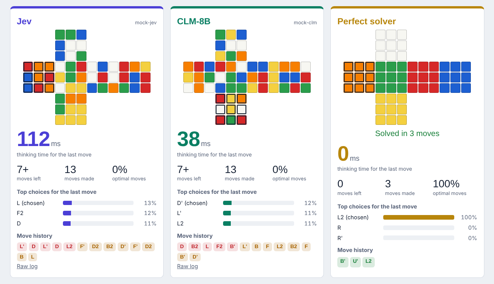
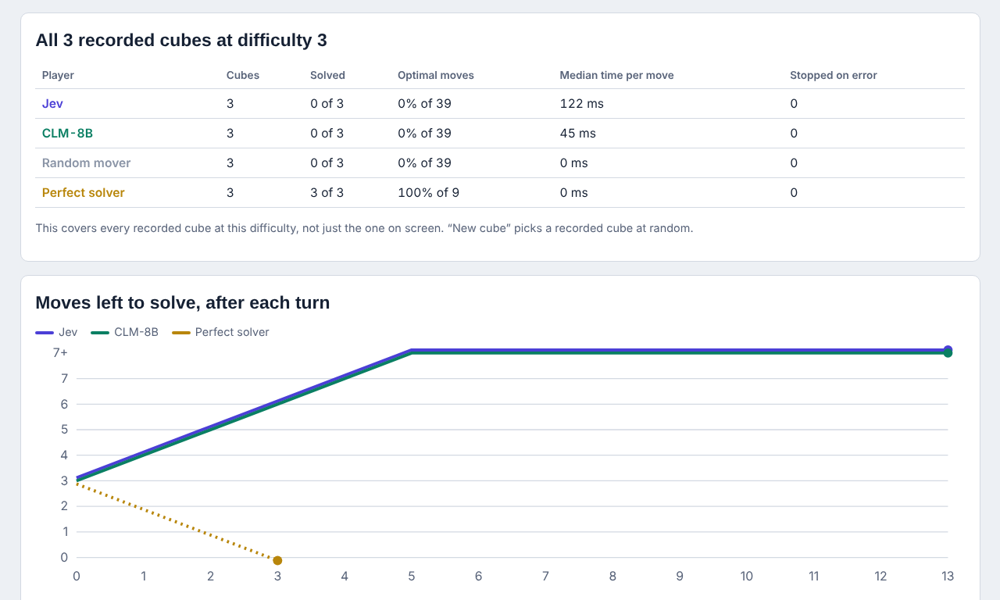
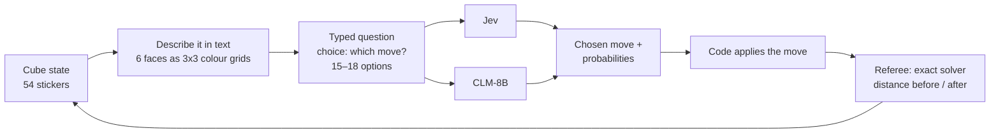

# Cube race

Jev and CLM play the same scrambled Rubik's cube, one move at a time. A perfect solver referees every move, and two baselines (a random mover and the perfect solver itself) show the floor and the ceiling.



<sub>Screenshot from a rehearsal with the mock server (model names `mock-jev` / `mock-clm`), so the numbers are not real results.</sub>


> Why the models struggle here, with the measurement behind it: [docs/README.md, section 8](../docs/README.md#8-where-it-breaks-the-guard-and-the-cube). Every move is also listed in the page's **decision log** (player, move, probability, top alternatives, the solver's verdict, time), downloadable as CSV.

## What the audience sees

* **One lane per player**, always in the same colour: Jev indigo, CLM teal, random grey, perfect solver gold.
* **The unfolded cube** after every move, with the face that was just turned outlined.
* **A stopwatch** counting while the model "thinks", then freezing on the measured time.
* **Every move graded** by the referee: <code>optimal</code> (one step closer, the best possible), <code>neutral</code> (no progress), <code>worse</code> (further away).
* **The top 3 choices** with probabilities, so you can see how sure the model was.
* **A chart of "moves left to solve"** per player, plus a summary over *every* recorded cube.



## What happens under the hood



Each turn is one **System One decision**: unstructured state in, one typed choice out. The surrounding code does only two things, the "smart if-statement" pattern:

1. **It limits the options.** With the default rule, a model may not turn the same face twice in a row (that is always wasteful), so it chooses from 15 moves instead of 18.
2. **It applies the chosen move.** The model never edits the cube itself.

### The exact request both models get

Both models receive byte-for-byte the same request (`agents/players.py`):

```text
state:
  A Rubik's cube. Each face is a 3x3 grid of sticker colours, as seen when looking straight at that face.
  Top face (white centre):
    white white green
    ...
  Stickers already matching their face's centre: 38 of 54.
  Previous move: R.
  Goal: solve the cube so every face shows a single colour.

question (choice): Which single move brings this Rubik's cube closest to being solved?
  U  : "U: turn the top face (white centre) a quarter turn clockwise"
  U' : "U': turn the top face (white centre) a quarter turn counter-clockwise"
  U2 : "U2: turn the top face (white centre) a half turn (180°)"
  ... (15 or 18 options)
```

The **Raw log** link under each lane shows the full request and response for every move.

### The referee

`cube/oracle.py` knows the exact number of moves left for any cube up to 7 moves from solved:

* At start-up it searches outward from the solved cube and stores every state within 4 moves (46,741 states, under a second).
* To measure a cube, it searches up to 3 moves forward from it and looks the results up in that table.
* 4 + 3 means the answer is exact up to 7 moves. Beyond that the page shows "7+".

That's why the difficulty levels are 1–7: level 3 means "exactly 3 perfect moves solve it", checked by the referee, not just 3 random turns.

### The cube engine

`cube/cube_state.py` derives every move from 3D geometry: each sticker has a position and a direction, the layer is rotated 90°, and the code reads off where each sticker landed. The first version used hand-typed move tables, and three of six moves were wrong (U and D turned backwards, and B produced unsolvable cubes). The tests now check every move against standard reference strings and known facts, e.g. (R U) repeated 105 times returns to solved.

## How to run it

**In the web app** (from the repository root): `uvicorn webapp.app:app --port 8000`, then open http://localhost:8000/cube.

**Recorded (default).** Each player is recorded on its own, one move at a time, and the page replays the moves at their real speed. Record before the lecture, from this folder:

```bash
python -m runner.record --players clm random oracle --levels 2 3 4 --cubes 10 --where "GPU box, BHT"
python -m runner.record --players jev --levels 2 3 4 --cubes 10 --where "Laptop, Berlin"
```

Cube *k* at level *L* always has the same scramble, so recordings from different machines and days line up cube by cube. "New cube" on the page picks a recorded cube at random, and the summary table always covers all of them.

**Live.** Switch the page to Live: every move asks the models right now.

**In the terminal:**

```bash
python -m runner.race --level 3 --players jev clm random oracle
python -m pytest tests            # engine, solver and scrambler tests
```

## Files

| File | What it does |
| :--- | :--- |
| `cube/cube_state.py` | Sticker layout, the 18 moves (derived from 3D geometry), helpers |
| `cube/oracle.py` | Exact "moves left to solve" referee (up to 7 moves) |
| `cube/scrambler.py` | Seeded scrambles; `scramble_exact()` gives a cube exactly N moves from solved |
| `agents/players.py` | The four players, the shared request, the `play()` game loop and the `judge()` referee call |
| `agents/recorded.py` | Loads recordings for replay and builds the summary |
| `runner/record.py` | Records games, one player at a time |
| `runner/race.py` | Live race in the terminal |
| `tests/test_cube.py` | Engine and solver tests |

The web page itself is in `../webapp/static/cube.html` and `cube.js`.

## Talking points

* **Speed adds up.** A model that needs 400 ms per move needs 4 s for 10 moves. This is why System One latency matters for agents that take many steps.
* **The honest limit.** Solving a cube means planning several moves ahead; a one-shot decision model only sees the next move. Expect Jev and CLM to be much closer to the random mover than to the perfect solver. That's the System 1 vs System 2 point of the talk: use the fast model for the decision at hand, and planning or search (or a System 2 model) for the long game.
* **What to compare.** The optimal-move rate against the random mover's shows whether a model has *any* sense of the cube. Usually only one or two of the 15–18 moves are optimal, so random play scores about 7%. Time per move shows the cost.
