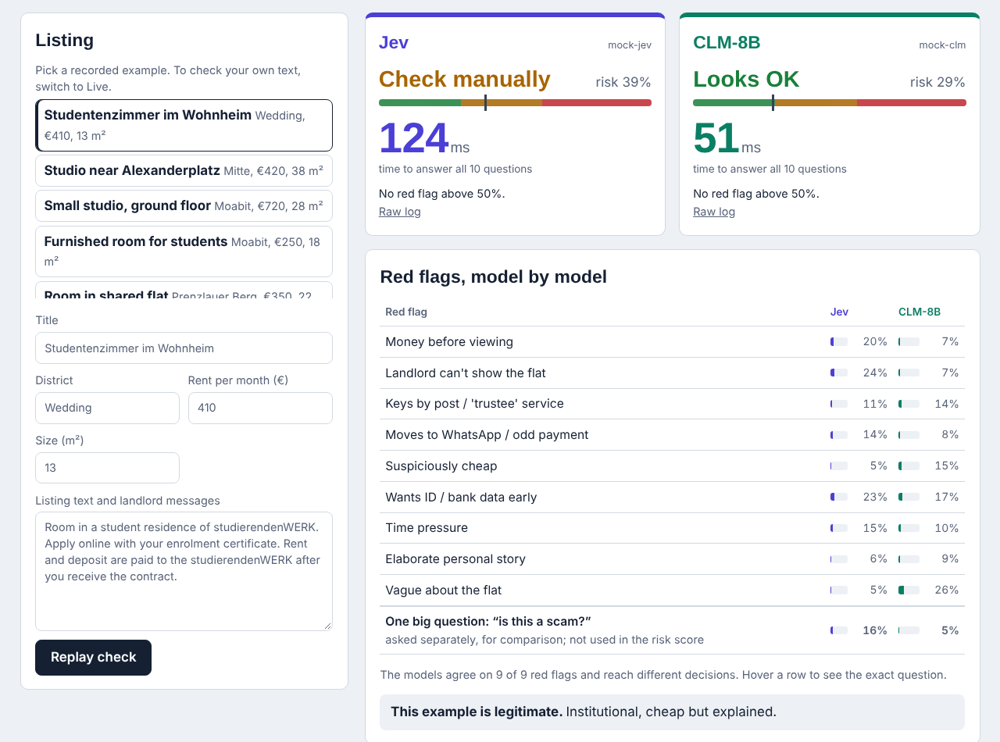
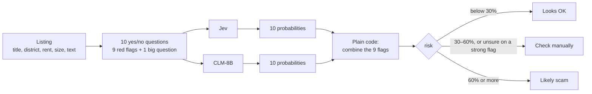

# Scam check: is this Berlin flat a scam?

Paste a flat listing, or pick one of 30 examples. Instead of one big "scam or not?" question, Jev and CLM each answer nine small yes/no questions, the red flags a careful flat-hunter checks. Plain code then combines the answers into a risk score with reasons.



<sub>Screenshot from a rehearsal with the mock server (model names `mock-jev` / `mock-clm`), so the numbers are not real results.</sub>

## What the audience sees

* **A verdict per model**: *Looks OK*, *Check manually* or *Likely scam*, with a risk percentage and the main reasons.
* **A stopwatch per model.** In recorded mode each verdict appears after that model's own recorded time, so the faster model visibly answers first.
* **A red-flag table** with both models' probabilities next to each other. Rows where the models disagree are marked.
* **"One big question" for comparison**: the models are also asked "is this a scam?" directly, so you can compare one big question against checklist plus code.
* **"Reveal the correct answer"**: the list is shuffled and the label is hidden, so the audience can guess first.
* **A summary over all recorded listings** (correct decisions, median and 95th-percentile time).

## What happens under the hood



### The nine red flags

Each flag is a yes/no question (`noul` in the Jev/CLM API); the answer is the probability that it is true. Strength says how much a flag alone should worry you.

| Red flag | Strength |
| :--- | ---: |
| Asks for money before a viewing or contract | 0.60 |
| Keys by post / courier, or a "trustee" / payment-protection service | 0.60 |
| Landlord can't show the flat in person (e.g. lives abroad) | 0.50 |
| Moves to WhatsApp, private email, Western Union, crypto, gift cards | 0.35 |
| Rent far below normal for size and location | 0.30 |
| Wants ID, bank details or payslips before any viewing | 0.25 |
| Time pressure | 0.20 |
| Elaborate personal story explaining the odd arrangement | 0.20 |
| Vague about the flat itself | 0.10 |

The full question texts are in `scam/detector.py`. Hover a row on the page to see them.

### Combining: each flag is an independent reason for suspicion

```text
risk = 1 − (1 − strength₁·p₁) · (1 − strength₂·p₂) · … · (1 − strength₉·p₉)
```

* No flag at all gives a risk of about 0.
* One certain strong flag (p = 1, strength 0.6) gives 60%, which is already *Likely scam*.
* Two medium flags add up.
* If a strong flag (strength ≥ 0.5) is answered close to 50/50, the listing goes to *Check manually* whatever the total. An unsure model should hand over to a human, not guess.

This is the pattern from the talk: **decompose into small typed questions, combine in code, route uncertainty to a person.** Every decision can be explained flag by flag.

## The data

`data/listings.jsonl` has **30 synthetic listings** (15 scams, 15 legitimate) written for this demo. Each has a label and a one-line explanation (`why`). Some are deliberately tricky:

* Legit, but with red-flag words: the landlord is abroad but a friend shows the flat; a cooperative share is paid upfront after signing; time pressure from someone who needs a Nachmieter.
* Scams that are more subtle: "the current tenant is very private, so no viewing".

Add real listings (with labels) to make the evaluation more meaningful. 30 synthetic examples are a classroom illustration, not a benchmark.

## How to run it

**In the web app** (from the repository root): `uvicorn webapp.app:app --port 8000`, then open http://localhost:8000/scam.

**Recorded (default).** Record each model separately before the lecture (from the repository root):

```bash
python scam-detector-demo/record.py --providers clm --where "GPU box, BHT"
python scam-detector-demo/record.py --providers jev --where "Laptop, Berlin"
```

If a listing's text is edited later, its old recording is ignored (each recording stores a fingerprint of the text).

**Live.** Switch to Live to check your own text. Both models are asked at the same time.

**Evaluation for the data science part:**

```bash
python scam-detector-demo/evaluate.py
```

It makes no model calls: it reads the same recordings the page replays, so slide numbers and replays always match. It writes `results/report.md` and `results/predictions.csv` with, per model:

| Metric | How to read it |
| :--- | :--- |
| AUC, checklist risk | Chance that a random scam gets a higher risk than a random legit listing (1.0 = perfect ranking, 0.5 = coin flip) |
| AUC, one big question | Same, for the direct "is this a scam?" question: does decomposing help? |
| AUC, logistic regression (LOO) | A model *learned* from the 9 flag probabilities, with leave-one-out cross-validation, against the hand-set strengths |
| Brier score | Mean squared error of the big question's probability (lower is better; rewards being right *and* honest about uncertainty) |
| Calibration bins | When a model says 80%, is it a scam about 80% of the time? |
| Accuracy, precision, recall | When "check" or "warn" counts as flagged |
| Median / 95th-percentile latency | Typical and worst-case waiting time |

The report also lists the learned weights next to the hand-set strengths, and every listing each model got wrong.

## Files

| File | What it does |
| :--- | :--- |
| `scam/detector.py` | Red flags, the questions, `combine()`, decision thresholds |
| `scam/recorded.py` | Loads recordings for replay and evaluation |
| `record.py` | Records one model at a time over all listings |
| `evaluate.py` | Metrics from the recordings |
| `data/listings.jsonl` | 30 labelled synthetic listings |

The web page itself is in `../webapp/static/scam.html` and `scam.js`.

## Talking points

* **Small questions beat one big one** (check this with the AUC rows): each answer is easier for the model, and the decision becomes explainable.
* **Calibration matters for automation.** A threshold only works if "80% sure" really means right about 80% of the time.
* **The cost of a wrong call is asymmetric.** Missing a scam can cost a deposit; flagging a legit flat costs a second look. That's why there's a *Check manually* band instead of a hard yes/no.
